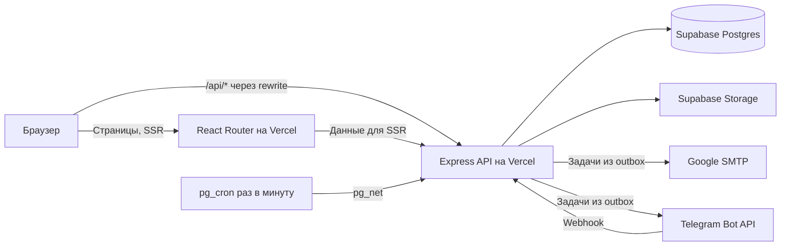

# Техническое задание на сайт ARMORIX

**Версия 0.3 · 10 ноября 2026 · ARMORIX — рабочее название**

Сайт помогает владельцу внедорожника подобрать защиту бампера, отправить заявку и продолжить общение с менеджером. Сотрудники управляют витриной и заявками, а клиент в кабинете видит историю обращений, подтверждённые покупки и бонусы. Оплата, выдача и установка согласуются отдельно. В интерфейсе сайта нет онлайн-оплаты.

Проект выпускается двумя релизами. **Релиз 1 (ядро)** — витрина, каталог, подборка, заявки, админка, подтверждение продаж менеджером, письма о заявке и Telegram. **Релиз 2** — кабинет клиента, бонусы, акции, новости и рассылка. Код релиза 2 попадает в основную ветку выключенным за флагами и включается отдельно. Стартовая цена в каталоге отображается в формате **«от … ₽»**, а отправленная заявка автоматически сохраняется в базе и попадает в работу менеджера. Инфраструктура — только бесплатные тарифы Vercel и Supabase, без собственного сервера.

**Источники проекта** — черновик `armorix-spec.txt`, бриф `Задание 10.11.docx`, решения Егора в чате и [визуальный плейбук ARMORIX](ARMORIX-playbook.md). Черновик уточняет исходный бриф. Подборка товаров передаётся как одна заявка, поэтому закрывает потребность в «корзине» без оформления покупки на сайте. Плейбук задаёт графику и правила интерфейса, это ТЗ задаёт поведение и архитектуру.

### Что изменилось относительно 0.2

- Размещение: Vercel (сайт и API) + Supabase (Postgres и хранилище файлов) на бесплатных тарифах. SQLite, постоянный диск, отдельный процесс-воркер и пересборка сайта через Deploy Hook убраны. Публичные страницы рендерятся на сервере (SSR).
- Убраны требования про размещение и локализацию данных в РФ.
- Вход клиента — email-код и Telegram Login с первого дня кабинета. Телефон подтверждается через бота, поэтому телефонные заявки тоже привязываются к аккаунту.
- Бонус за заявку — разовый приветственный, один раз на аккаунт навсегда.
- Зафиксированы способы получения, причины закрытия заявки, второй фактор сотрудников (TOTP), защита форм от ботов, таблицы `user_roles` и `posts`.
- Формулировки «можно / предлагается» заменены решениями.
- Почта — Google SMTP (Workspace relay или Gmail) с дневным лимитом, рассылка укладывается в этот лимит.

## 1. Роли и права

| Роль | Возможности |
| --- | --- |
| Посетитель | Смотреть витрину и акции, подбирать комплект, отправлять заявку, подписываться на рассылку, входить в кабинет. |
| Клиент | Дополнительно просматривать свои заявки, подтверждённые покупки, баланс и историю бонусов, менять профиль и управлять подпиской. |
| Менеджер | Обрабатывать заявки, фиксировать результат общения и подтверждённые продажи, видеть данные клиентов в рамках своей работы. |
| Редактор | Вести каталог, цены, публикации и акции. Просмотр контактных данных и подтверждение продаж выдаются отдельными правами. |
| Администратор | Управлять ролями, правилами бонусов и рассылками, разбирать ошибки доставки, выполнять корректировки с записью причины. |

Один сотрудник может совмещать роли, роли хранятся в `user_roles`. Права проверяются на API для каждого запроса. Изменения цены, статуса, продажи, бонусов, прав и рассылки фиксируются в журнале. Публичная регистрация выдаёт только роль клиента. Доступ сотрудников создаёт администратор.

## 2. Страницы и пользовательские сценарии

| Адрес | Что должно работать | Релиз |
| --- | --- | --- |
| `/` | Понятный первый экран, переход к каталогу, готовые комплекты, короткая история компании, преимущества, индивидуальное изготовление, актуальная акция при наличии и контакты. | 1 |
| `/catalog` | Подбор по автомобилю, каталожные фильтры, цены «от», карточки и переход в подборку. | 1 |
| `/catalog/:slug` | Фото, модель и совместимость, состав, материалы и монтаж по подтверждённым данным, цена «от», действия «В подборку» и «Уточнить комплектацию». | 1 |
| `/selection` | Добавленные позиции, количество, удаление, выбор способа получения и отправка одной заявки. | 1 |
| `/about` | История и подход компании, производство, материалы, установка и доставка. Контактные ссылки показываются после подтверждения. | 1 |
| `/contacts` | Подтверждённые каналы связи, часы работы, адрес при наличии, форма общего или индивидуального запроса. | 1 |
| `/privacy` | Сведения об обработке данных и текст согласия на рассылку. | 1 |
| `/admin/*` | Очередь заявок, карточки клиентов по правам, подтверждённые продажи, каталог, журнал. В релизе 2 добавляются акции, новости и рассылка. | 1 |
| `/login`, `/account/*` | Вход и выход, профиль, заявки, покупки, бонусы, подписка. | 2 |
| `/offers` и `/offers/:slug` | Опубликованные акции с условиями, сроками и применимостью. | 2 |
| `/news` и `/news/:slug` | Новости о производстве. Тот же механизм публикации `posts`, тип `news`. | 2 |

Основные действия на мобильном видны без наведения. Целевой путь из главной — выбрать автомобиль, открыть комплект и отправить заявку. Пользователь может перейти к подборке с любой публичной страницы. На ширинах 320, 390, 768, 1024 и 1440 px проверяются меню, фильтры, форма, кабинет и рабочие страницы админки.

Состояния загрузки, пустого списка, ошибки и подтверждения нужны для каждого запроса, который меняет экран. Ошибка формы сохраняет введённые поля, а статус отправки озвучивается для программ чтения с экрана. Навигация использует видимый фокус, понятные названия кнопок и обратный путь из карточки. Стальные ассеты из плейбука используются как декоративный слой. Для интерфейса сохраняются читаемые контрасты, статичный режим при отключённых анимациях, фирменная индикация загрузки и скроллбар.

### Каталог и цена

- Первый фильтр — марка и модель. Стартовые автомобили по брифу — JAC T9 и Haval H3. Модельный год, поколение, кузов или комплектацию использовать только там, где эти признаки действительно меняют совместимость. Состав комбинаций хранить в справочнике, чтобы администратор не мог создать заведомо несовместимый вариант.
- Вторая группа фильтров — передняя или задняя защита, комплект, материал или покрытие. Фильтр показывается, когда у него есть хотя бы два значения среди опубликованных позиций выбранной модели. Состояние фильтров отражается в URL. Ссылки из карточек и кнопка «Назад» сохраняют контекст. При нулевой выдаче показывать сброс и переход к индивидуальной заявке.
- Цена «от» — минимальная подтверждённая цена доступного варианта в выбранном контексте. Если вариант указан в фильтре, цена рассчитывается среди совпадающих вариантов. Не подставлять цену другого автомобиля или недоступной комплектации. Для отсутствующей цены использовать «Уточнить цену». Под числом пояснить, что окончательная стоимость зависит от комплектации и подтверждается менеджером. Хранить суммы в копейках и валюту `RUB`.
- Описание содержит код товара, фото, совместимость, тип защиты, подтверждённый материал, состав комплекта, способ установки и статус предложения. Бриф описывает нержавеющую сталь AISI 304 с зеркальной полировкой и чёрный металл с порошковым покрытием для ассортимента в целом. Привязка материала, крепежа и утверждений об установке к конкретному комплекту проверяется перед публикацией.
- Состояния товара — черновик, опубликован, скрыт или архив. Архив сохраняет старые заявки. Снять товар или вариант с витрины можно без потери истории. В админке фото сортируются, у основного фото задаётся альтернативное описание. Опубликованные карточки используют реальные фото или явно подписанные иллюстрации.

### Подборка и форма

Подборка хранит идентификаторы вариантов и количество. Для гостя она хранится в браузере без имени, телефона и email. В релизе 2 подборка вошедшего клиента сохраняется в аккаунте. Синхронизация подборки между устройствами в релизы не входит, формат заявки её не требует.

Перед отправкой API перепроверяет актуальность позиций, совместимость и стартовые цены. Если вариант пропал или цена поменялась, показать, что изменилось, дать исправить или подтвердить обновлённые условия. Сумму заказа и обещание резерва сайт не формирует. Подборка может содержать товары для нескольких автомобилей, модель фиксируется для каждой позиции.

**Способы получения** — «Самовывоз», «Доставка транспортной компанией», «Установка у нас». Список хранится в справочнике, администратор может отключить способ. Если включён один способ, выбор не показывается.

| Вид обращения | Поля |
| --- | --- |
| По каталогу | Позиции и количество из подборки, имя, телефон или email, предпочтительный контакт, способ получения, комментарий по желанию. |
| Индивидуальное изготовление | Марка, модель, год при наличии, что нужно изготовить, имя и способ связи. Фотографии обсуждаются с менеджером через подтверждённый канал. |
| Общий контакт | Имя, телефон или email и текст обращения. |

- Запрашивать один рабочий контакт. Если выбран звонок, нужен телефон. Если email — email. Телефон хранить в нормализованной форме E.164, а ошибки возвращать рядом с полями. Для авторизованного клиента подставлять данные профиля с возможностью изменить контакт для заявки. Такая замена не меняет профиль или привязку заявки к аккаунту.
- Защита от ботов: скрытое поле-ловушка (honeypot), минимальное время заполнения формы, лимиты частоты по IP и по контакту, ограничение длины полей. Срабатывание ловушки отвечает пользователю как обычный успех, но заявку не создаёт и уведомлений не ставит.
- По нажатию «Отправить заявку» в одной транзакции создаются заявка, её позиции со снимком названий и цен «от», состояние бонуса (с релиза 2) и задачи уведомлений. Форма показывает номер заявки после записи в базу. Сбой письма или Telegram не влияет на принятие заявки. При тайм-ауте повтор с тем же ключом возвращает прежний номер. После успеха очищается только отправленная подборка.
- В кабинете (релиз 2) заявки показываются для аккаунта, из которого они созданы. Гостевая заявка привязывается после подтверждения контакта, указанного при отправке: email — одноразовым кодом, телефон — через Telegram-бота (раздел 4). Совпадение введённого адреса или телефона само по себе доступа не даёт. Менеджер может привязать заявку вручную после проверки по своему каналу, с записью в журнал.

## 3. Рабочий процесс менеджера

`Новая → В работе → Предложение согласовано → Продажа подтверждена`

Из рабочего статуса можно закрыть заявку без продажи с причиной: «Не удалось связаться», «Не подошла цена», «Нет совместимого решения», «Дубль или спам», «Другое» с обязательным комментарием. Отмена до подтверждения завершает работу с заявкой. Возврат после продажи оформляется отдельным событием. В журнале видны исполнитель, время, предыдущий и новый статус, причина ручной корректировки. Публичные статусы в кабинете проще внутренних и не показывают служебные заметки.

При отправке заявки система автоматически создаёт запись в базе, историю статуса, запись о бонусах (с релиза 2) и задачи уведомления. Из неё менеджер открывает подготовленную карточку сделки с уже заполненными контактами и позициями. Для подтверждения продажи нужны фактическая сумма, дата и уникальный идентификатор сделки или документа. Привязка к клиенту с аккаунтом позволяет показать покупку в кабинете и учесть её в акциях. Если продажа проходит без аккаунта, запись хранится отдельно и привязывается через проверенный контакт. Повтор одного подтверждения не создаёт вторую продажу и не увеличивает счётчик покупок. Автоматическое подтверждение из CRM или кассы в релизы не входит и добавляется, когда появится система-источник.

В админке нужны поиск по номеру и разрешённым контактам, фильтры по статусу, дате и ответственному, смена ответственного, история действий и повтор отправки уведомления. Каталог и публикации имеют черновик, предпросмотр, публикацию и архив. Конфликт двух правок показывается сотруднику через версию записи. Публикация проверяет обязательные поля, совместимость, корректность даты и цену.

## 4. Кабинет и авторизация

- **Сотрудники (релиз 1).** Доступ создаёт администратор приглашением на email. Вход — одноразовый код на email, затем второй фактор TOTP (RFC 6238, любое приложение-аутентификатор). При подключении TOTP выдаются одноразовые коды восстановления, хранятся в виде хешей. Без подтверждённого TOTP административные маршруты не открываются.
- **Клиенты (релиз 2).** Два способа входа с первого дня кабинета: одноразовый код на email и Telegram Login по официальному потоку ([Telegram Login](https://core.telegram.org/bots/telegram-login)), отдельно от webhook бота. Внешний аккаунт идентифицируется по `provider + subject`. Привязка второго способа входа разрешена из активной сессии после повторного подтверждения. Аккаунты не объединяются автоматически по совпавшему email. VK ID и Google в релизы не входят.
- **Подтверждение телефона через Telegram (релиз 2).** Telegram Login работает по OIDC и со scope `phone` отдаёт в подписанном `id_token` подтверждённый номер аккаунта Telegram (`phone_number`). Сервер проверяет подпись по JWKS Telegram, `iss`, `aud` (ID бота), срок и одноразовый `nonce`, нормализует номер и помечает его подтверждённым, если этот номер не подтверждён у другого кабинета. Тот же поток используется для входа и для привязки Telegram к существующему кабинету (из свежей сессии). Отдельный диалог с ботом через `request_contact` не нужен (решение 2026-11-10, проверено по документации Telegram Login).
- **Привязка гостевых заявок (релиз 2).** Кабинет показывает гостевые заявки последних 180 дней, у которых email или телефон совпадает с подтверждённым контактом кабинета (email подтверждается кодом при входе, телефон через Telegram). Клиент явно выбирает, какие привязать; ожидающий бонус проводится по правилам раздела 5. Совпадение неподтверждённого контакта доступа не даёт.
- **Коды и лимиты.** Код одноразовый, хранится в виде HMAC с серверным секретом. Срок 10 минут, повторная отправка через 60 секунд, до пяти попыток проверки на запрос, дополнительные лимиты по контакту и IP. После превышения лимита выдаётся нейтральное сообщение. Ответ на запрос кода одинаков для нового и существующего клиента. Счётчики лимитов хранятся в Postgres, потому что у серверных функций нет общей памяти.
- **Сессии.** После проверки выдаётся серверная сессия с непрозрачным токеном в cookie. Токен хранится на сервере только в виде хеша. Идентификатор меняется при входе и повышении прав, сессия аннулируется при выходе.
- **Кабинет** показывает историю заявок со статусом и датой, подтверждённые покупки с суммой и составом, бонусный баланс и события, настройки контактов и подписки. Пустые разделы объясняют, когда появятся данные. Смена email подтверждает новый адрес и требует свежего входа.
- Доступ к каждой записи проверяется по владельцу на сервере. Угадываемый номер заявки не открывает детали. Частные страницы и их данные не попадают в sitemap, кеш CDN и индексируемый HTML.

## 5. Бонусы, акции и рассылка (релиз 2)

### Бонусная механика

**Приветственный бонус — один раз на аккаунт, навсегда.** Начисляется за первую подходящую заявку клиента: запрос из каталога или индивидуальное изготовление. Общий контакт бонус не даёт. Сумма баллов, срок действия, лимит списания и курс балла к рублю задаются настройками и утверждаются Егором. Повторной программы «за каждую заявку» нет. Гость видит сообщение, что баллы станут доступны после подтверждения контакта. У клиента с подтверждённым контактом они появляются сразу. Заявки, отправленные до включения релиза 2, бонус не получают.

- Хранить состояние права на бонус `pending`, `credited` или `ineligible`, идентификатор заявки, версию правила, сумму и крайний срок подтверждения на момент отправки. Срок использования самих баллов начинается с проведения. При подтверждении гостевой заявки сервер в одной транзакции проверяет владельца и лимит программы, закрывает ожидание и проводит начисление. При повторной отправке или одновременной привязке двух заявок ограничения базы позволяют провести только одно начисление.
- Проведённые операции хранятся в неизменяемом журнале `earn`, `redeem`, `reverse`, `expire`, `adjust`. Баланс считается из проведённых операций. У начисления есть уникальный ключ по заявке и версии правила, а лимит «один раз на клиента» обеспечивает отдельный уникальный ключ по клиенту и идентификатору программы. Изменение версии правила не обнуляет этот лимит.
- Списание выполняет менеджер при подтверждении сделки в той же транзакции, с проверкой доступного остатка. История показывает сумму, дату и основание. Возврат покупки возвращает списанные за неё баллы. Отмена начисления за заявку оформляется встречной записью с причиной, например при подтверждённом злоупотреблении или закрытии заявки как «Дубль или спам». При отрицательном остатке новое списание блокируется до урегулирования. Ручная корректировка требует причины и прав администратора. Сгорание баллов выполняет ежедневная задача.

### Акции

Поддерживаются публичные акции по датам и условия по числу подтверждённых покупок. Для условия «после N покупок» считаются предыдущие подтверждённые покупки клиента на момент применения акции. Полностью возвращённые покупки исключаются, частично возвращённые засчитываются. У акции есть название, срок, условия, применимые варианты, признак совместимости с другими акциями и состояние публикации. Акции и новости хранятся в одной таблице `posts` с полем `type` (`offer`, `news`), условия акции — в отдельной таблице правил. Время хранится в UTC, расчёт и отображение идут по часовому поясу бизнеса из настроек (по умолчанию `Europe/Moscow`). Право на закрытое предложение проверяется на сервере перед подтверждением сделки. Версия правила сохраняется в покупке, чтобы изменение условий не переписало историю. Клубная карта и реферальные механики в релизы не входят.

### Email-рассылка

- Подписка добровольная, отдельная от заявки и входа. Подтверждение адреса по ссылке обязательно (double opt-in). Хранить статус, время, версию текста согласия и источник. Отписка доступна по ссылке без входа и в кабинете. После отписки ещё не отправленные письма этому адресу пропускаются, даже если адрес уже был в выборке.
- Редактор создаёт черновик, отправляет тестовое письмо и планирует рассылку. Отправка кампании требует явного подтверждения сотрудника с правом рассылки. Тестовый контент и адреса допускаются на стенде.
- Отправитель — Google SMTP: Workspace SMTP relay или Gmail с паролем приложения, через сменный адаптер. Дневной лимит отправки задаётся настройкой `EMAIL_DAILY_LIMIT` с запасом под лимит аккаунта. Транзакционные письма (заявка, вход) имеют приоритет и резерв внутри лимита. Кампания отправляется пачками за несколько запусков задач. Когда дневной лимит исчерпан, остаток ждёт следующего дня.
- Задача доставки уникальна по кампании и подписчику. При временной ошибке SMTP повторять с задержкой, при постоянном отказе остановить попытки для адреса. Отчёт кампании: «в очереди / принято SMTP / отклонено / пропущено». Статус «доставлено» не отслеживается, у SMTP нет подтверждения доставки.
- Письмо о заявке содержит номер и краткое подтверждение, без лишних контактных данных. Рекламные письма содержат заголовки отписки в один клик ([RFC 8058](https://www.rfc-editor.org/rfc/rfc8058)). Для домена отправителя настраиваются SPF, DKIM и DMARC. [Google Workspace SMTP relay](https://knowledge.workspace.google.com/admin/gmail/advanced/route-outgoing-smtp-relay-messages-through-google)

## 6. Telegram (релиз 1)

Бот работает в том же API. Внутренние уведомления отправляются задачами из очереди через Bot API. Сообщение содержит номер заявки и ссылку на карточку в админке. Контактные данные и комментарии сотрудник смотрит после входа в админку. Получатели внутренних уведомлений задаются на сервере. Потеря связи с Telegram не блокирует форму или обработку заявки.

Для клиента бот поддерживает `/start` и кнопки «Каталог», «Оставить заявку» и «Связаться». Форма заявки открывается на сайте, кнопка контакта ведёт к проверенному каналу связи. Ссылка из карточки может передавать публичный контекст товара, например его короткий slug. Менеджерская ссылка открывает защищённую карточку заявки. С релиза 2 бот также обрабатывает подтверждение телефона (раздел 4).

Webhook принимается по HTTPS функцией API. Проверяется `X-Telegram-Bot-Api-Secret-Token`, `update_id` записывается с уникальностью, приём подтверждается после записи в базу, а ответ пользователю идёт задачей из очереди. Полные входные данные не пишутся в общие логи. [Telegram Bot API](https://core.telegram.org/bots/api) · [Telegram deep linking](https://core.telegram.org/bots/features#deep-linking)

## 7. Стек и развёртывание

| Слой | Решение |
| --- | --- |
| Фронтенд | React Router 7 в режиме фреймворка, TypeScript, Vite, SSR на Vercel с официальным пресетом `@vercel/react-router`. Токены, SVG и правила адаптации — из [визуального плейбука](ARMORIX-playbook.md). Публичные страницы рендерятся на сервере и кешируются CDN на короткое время. Кабинет и админка отдают оболочку с `Cache-Control: no-store`, данные запрашиваются после проверки сессии. [React Router on Vercel](https://vercel.com/docs/frameworks/frontend/react-router) |
| API | Node.js 24 LTS, Express 5, TypeScript, схемы валидации на сервере, версия `/api/v1`. Отдельный проект Vercel: Express разворачивается как одна функция на Fluid compute. Проект сайта проксирует `/api/*` в проект API через rewrite на внешний адрес, поэтому браузер работает с одним источником. [Express on Vercel](https://vercel.com/kb/guide/ship-a-express-app-on-vercel) · [Vercel Rewrites](https://vercel.com/docs/routing/rewrites) |
| База данных | Supabase Postgres, бесплатный тариф. Таблицы в схеме `app`, которая не публикуется через Data API Supabase. RLS включён на всех таблицах без разрешающих политик как второй барьер. API подключается через Supavisor в режиме транзакций (порт 6543): клиент создаётся один раз на экземпляр функции, пул 1 соединение, prepared statements выключены, SSL обязателен. SQL-миграции хранятся в репозитории и применяются из CI перед деплоем API. [Supabase — подключение](https://supabase.com/docs/guides/database/connecting-to-postgres) |
| Изображения | Supabase Storage. Функции Vercel принимают тело запроса до 4,5 МБ, поэтому редактор загружает оригинал напрямую в приватный бакет по подписанной ссылке от API. Затем API проверяет фактический формат, размер и разрешение, делает WebP-варианты и кладёт их в публичный бакет каталога. Трансформации Supabase на бесплатном тарифе недоступны, обработка своя. [Vercel Functions Limits](https://vercel.com/docs/functions/limitations) |
| Фоновые задачи | Постоянного процесса нет. Задачи лежат в таблице `outbox`. После фиксации транзакции обработчик пытается выполнить свои задачи сразу через `waitUntil`. Страховочный запуск — `pg_cron` в Supabase раз в минуту вызывает через `pg_net` защищённый маршрут `POST /api/v1/internal/jobs/run`; секрет хранится в Supabase Vault. Запуск захватывает задачи через `FOR UPDATE SKIP LOCKED` с арендой и укладывается в 60 секунд (лимит функции на Hobby — 300 секунд). Ежедневные SQL-задачи (сгорание баллов, очистка просроченных кодов и ключей идемпотентности) выполняет `pg_cron` прямо в базе. Vercel Cron не используется: на Hobby он запускается не чаще раза в сутки. [pg_net и pg_cron](https://supabase.com/docs/guides/database/extensions/pg_net) |
| Окружения | Два проекта Supabase (лимит бесплатного тарифа — два активных): продакшен и стенд. Превью-деплои Vercel подключаются только к стенду. |
| Запуск и CI | `pnpm` workspace с единым lockfile: `apps/web`, `apps/api`, `packages/contracts`. CI запускает типизацию, линтер, тесты, сборку и миграции. Версии Node.js, драйвера Postgres и пакетов закрепляются. |



Запись заявки, бонусные операции и подтверждение продажи выполняются короткими транзакциями Postgres. Вызовы внешних сервисов идут за пределами транзакций. Номера заявок выдаёт последовательность Postgres.

### Каталог и публикация

Публичные страницы рендерятся на сервере из того же публичного API, которым пользуется клиент. Ответы кешируются CDN с `s-maxage=60, stale-while-revalidate`. Публикация меняет запись в базе, а на сайте изменение появляется в течение минуты без пересборки. В админке после публикации показывается «Опубликовано, на сайте в течение минуты». Sitemap строится динамически из опубликованных записей и кешируется так же. Для смены slug сохраняется переадресация в таблице `slug_redirects`. Неизвестные публичные адреса возвращают HTTP `404` из загрузчика маршрута. Просроченные предложения не применяются на сервере независимо от кеша страницы. [Основы JavaScript SEO](https://developers.google.com/search/docs/crawling-indexing/javascript/javascript-seo-basics)

### Модель данных

| Сущности | Инварианты |
| --- | --- |
| `vehicle_models`, `products`, `variants`, `compatibilities`, `media`, `slug_redirects`, `delivery_methods` | У товара стабильный уникальный slug. Вариант связан с товаром, совместимость — с моделью и проверенными ограничениями. Цена целочисленная, доступность отдельным полем. |
| `leads`, `lead_items`, `lead_events` | Публичный номер уникален. Позиции содержат снимок при отправке. Хранить источник заявки, владельца при наличии, сотрудника, способ получения, причину закрытия и историю смены статуса. |
| `users`, `user_roles`, `identities`, `sessions`, `login_challenges`, `totp_factors` | Внешний идентификатор уникален внутри провайдера. Подтверждённый телефон и email хранятся с отметкой и способом подтверждения. Токены, коды и сроки их жизни отделены от профиля. Служебные идентификаторы не включаются в клиентский контракт. |
| `sales`, `sale_items`, `sale_events` | Источник и внешний идентификатор сделки уникальны вместе. Связь с заявкой опциональна для офлайн-продаж. Фактическая сумма хранится отдельно от цены «от». Возврат ссылается на исходную покупку. |
| `loyalty_rules`, `loyalty_awards`, `loyalty_ledger`, `posts`, `offer_rules` | Правила версионируются. Право на бонус связано с заявкой и версией правила. Уникальный ключ по клиенту и программе обеспечивает разовость приветственного бонуса. Журнал хранит причину, ссылку на событие и уникальный ключ операции. Применимость акции проверяется по сроку и подтверждённым продажам. |
| `subscriptions`, `consent_events`, `campaigns`, `campaign_deliveries` | Согласие, отзыв и версия текста доступны для проверки. Доставка уникальна по кампании и подписке. История статусов отделена от текущего согласия. |
| `outbox`, `idempotency_keys`, `rate_limits`, `audit_events`, `telegram_updates` | Внешняя задача записывается в той же транзакции, что и событие. Ключи идемпотентности ограничены типом операции и сроком. `update_id` Telegram уникален. Журнал аудита не содержит паролей, кодов и тел писем. |

В заявке и покупке сохраняются исторические снимки. Правка каталога или удаление фото не меняют содержимое отправленной заявки. Удаление и обезличивание контактных данных проектируются отдельно от финансовой истории.

### API

| Метод и маршрут | Контракт | Релиз |
| --- | --- | --- |
| `GET /meta` | Включённые флаги релиза 2, способы получения, публичные контакты. | 1 |
| `GET /vehicles`, `GET /catalog`, `GET /catalog/:slug`, `GET /sitemap` | Опубликованные модели, варианты и карточки. Фильтры и пагинация проверяются сервером. Для позиции возвращать идентификатор, цену «от» в копейках или `null`, статус и подтверждённую применимость. | 1 |
| `POST /leads` | Каталожная, индивидуальная или общая заявка. `201` после записи заявки, повтор возвращает тот же номер. `422` с ошибками полей, `409` при изменившемся каталоге или повторе ключа с другим телом, `429` при ограничении частоты. | 1 |
| `POST /auth/email/request`, `POST /auth/email/verify`, `POST /auth/totp/verify`, `POST /auth/logout` | Одноразовый вход, второй фактор сотрудника, создание и отзыв сессии. | 1 |
| `/admin/leads`, `/admin/catalog`, `/admin/sales`, `/admin/users` | Список и необходимые операции по ролям. Обновление требует актуальной версии записи, конфликт возвращает `409`. | 1 |
| `POST /admin/media/upload-url`, `POST /admin/media/:id/process` | Подписанная ссылка на загрузку оригинала и его проверка с обработкой. | 1 |
| `POST /admin/sales/:id/confirm`, `POST /admin/sales/:id/refunds` | Подтверждение сделки и возврат. В одной транзакции записываются статус, журнал, операции бонусов (с релиза 2) и задачи уведомления. | 1 |
| `POST /admin/catalog/:id/publish` | Публикация товара с проверкой полей. | 1 |
| `POST /webhooks/telegram` | Проверка секрета, обработка повторов, ограничение размера тела. | 1 |
| `POST /internal/jobs/run` | Запуск обработки очереди. Доступ только по секрету из Supabase Vault. | 1 |
| `POST /auth/telegram` | Вход клиента через Telegram Login. | 2 |
| `GET/PATCH /me`, `GET /me/leads`, `GET /me/purchases`, `GET /me/loyalty` | Только данные авторизованного клиента. Смена контакта подтверждается отдельным одноразовым запросом. | 2 |
| `POST /auth/telegram/nonce`, `POST /me/identities/telegram` | Одноразовый nonce для Telegram Login; привязка Telegram к кабинету из свежей сессии, с подтверждённым телефоном из токена. | 2 |
| `GET /me/leads/claimable`, `POST /me/leads/claim` | Список гостевых заявок по подтверждённым контактам и их явная привязка с проведением ожидающего начисления. Один номер заявки не даёт доступа к данным. | 2 |
| `POST /me/email/request`, `POST /me/email/verify` | Смена email из свежей сессии с кодом на новый адрес. | 2 |
| `GET /offers`, `GET /offers/:slug`, `GET /news`, `GET /news/:slug` | Публичные материалы и сроки. Частную применимость определяет защищённая логика по аккаунту и покупкам. | 2 |
| `POST /subscriptions`, `POST /subscriptions/confirm`, `POST /subscriptions/unsubscribe` | Подписка, подтверждение и отзыв согласия. GET-страница ссылки показывает форму подтверждения действия. Повторная отписка проходит без ошибки, отдельный POST для отписки в один клик. | 2 |
| `/admin/offers`, `/admin/posts`, `/admin/campaigns`, `POST /admin/campaigns/:id/schedule` | Акции, новости, кампании. Планирование кампании проверяет права и дневной лимит. | 2 |

Пути в таблице идут после `/api/v1`. Для JSON-ошибки достаточно полей `code`, `message`, `fieldErrors` и `requestId`. Для отправки формы передавать `Idempotency-Key` и использовать ключ до получения ответа, который однозначно завершает попытку. Сервер сравнивает нормализованный отпечаток запроса с уже принятой версией. Изменённая и подтверждённая пользователем подборка отправляется с новым ключом. Ключи не дают права читать детали заявки.

Ответ на созданную заявку. Номер служит для общения с менеджером. Поле `loyaltyStatus` появляется с релиза 2.

```json
{
  "reference": "AX-000123",
  "status": "received",
  "loyaltyStatus": "pending"
}
```

При устаревшей подборке ответ `409 CATALOG_CHANGED` перечисляет изменённые идентификаторы, доступность и актуальную цену «от». Клиент показывает изменения и оставляет решение за пользователем. До подтверждения обновлённой подборки заявка и внешние уведомления не создаются.

### Очередь задач и сбои

Состояния задач `pending`, `processing`, `sent`, `failed`, `needs_review`. Запуск атомарно захватывает задачу с арендой. Если функция оборвалась, истёкшая аренда возвращает задачу в работу на следующем запуске. Временные сбои повторяются с возрастающей задержкой. После исчерпания попыток задача видна в админке с безопасным описанием ошибки. Повтор вручную использует тот же идентификатор события.

При тайм-ауте после вызова отправки возможна неопределённость, было ли сообщение принято. Для массовой рассылки такая задача уходит в `needs_review` вместо слепого повтора. Повторное уведомление не меняет заявку, сделку или бонусный баланс. Состояние очереди целиком в базе, поэтому перезапуск функций ничего не теряет.

## 8. Безопасность и данные

- Сайт и API работают только по HTTPS. Браузер обращается к API через тот же адрес сайта (`/api/*`), поэтому CORS не нужен. Это важно и без своего домена: адреса `*.vercel.app` разных проектов браузер считает разными сайтами. Cookie сессии — `__Host-` с `HttpOnly`, `Secure`, `SameSite=Lax`, `Path=/`, без `Domain`. Изменяющие запросы проверяют `Origin` и CSRF-токен.
- Пароль базы и сервисный ключ Supabase хранятся только в переменных окружения проекта API. В сборку сайта ключи Supabase не попадают, публичный ключ Supabase не используется. Стенд использует отдельный проект Supabase и свои секреты.
- Публичная форма ограничена по размеру, частоте запросов и длине полей. SQL только с параметрами, пользовательский текст экранируется при выводе, типы медиа ограничены. Секреты, коды, данные клиентов и токены не попадают в публичную сборку, тестовые снимки и логи. Логи содержат `requestId`, технический код события, длительность и результат.
- Частные ответы отдаются с `Cache-Control: no-store`. Превью-деплои подключаются только к стенду и не используют продакшен-сессии.
- Перед запуском публикуются сведения об обработке данных и текст согласия на рассылку, задаются сроки хранения заявок и порядок удаления контактов по запросу. Подписка на рекламную рассылку — отдельное добровольное действие.
- **Резервные копии.** На бесплатном тарифе Supabase автоматических копий нет. Ежедневная задача CI по расписанию снимает `pg_dump` базы и копию бакетов Storage, шифрует и хранит вне Supabase. Ориентиры — потеря данных не более суток, восстановление за четыре часа. Перед релизом 1 провести пробное восстановление копии в проект стенда.
- **Мониторинг.** Ежедневная проверка шлёт администратору в Telegram сообщение о просроченных задачах очереди, неудачной копии и приближении к лимитам Supabase (500 МБ базы, 1 ГБ файлов) и дневному лимиту почты.

## 9. Разработка и приёмка

Порядок работ на стенде:

1. **Витрина и каталог.** Маршруты, SSR, мобильная навигация, фильтры, карточки, цена «от» и подборка.
2. **Заявки и админка.** Транзакционная запись, проверка повторов, защита от ботов, вход сотрудников с TOTP, роли, управление каталогом и медиа, статусы, продажи, журнал, очередь задач, письма о заявке и Telegram.
3. **Выпуск релиза 1.** Реальные карточки, интеграции, восстановление из копии, проверка сценариев релиза 1, продакшен.
4. **Кабинет.** Вход по email и Telegram, подтверждение телефона через бота, привязка заявок, история покупок. За флагом `FEATURE_ACCOUNT`.
5. **Бонусы, акции, новости и рассылка.** Флаги `FEATURE_LOYALTY`, `FEATURE_OFFERS`, `FEATURE_NEWS`, `FEATURE_CAMPAIGNS`. Включение — после проверки на стенде и утверждения правил бонуса.

| Сценарий | Что считается выполненным | Релиз |
| --- | --- | --- |
| Подбор | По JAC T9 и Haval H3 выдаются только совместимые позиции. Перезагрузка сохраняет фильтры, цена «от» совпадает с доступным вариантом, отсутствующая цена не подменяется нулём. | 1 |
| Заявка | Повтор после тайм-аута показывает один номер. При выключенной почте заявка видна в админке, уведомление остаётся в очереди и уходит после восстановления. Архивирование товара сохраняет старую заявку. Срабатывание ловушки не создаёт заявку. | 1 |
| Индивидуальный запрос | Пользователь может обратиться по другой модели, включая нулевую выдачу каталога. Менеджер видит тип запроса и описание. | 1 |
| Права сотрудников | Без TOTP админка не открывается. Сотрудник без права просмотра контактов их не видит. Подмена ID в запросах не раскрывает чужие данные. | 1 |
| Публикация | Опубликованный товар появляется на сайте в течение минуты, снятый — исчезает и отдаёт `404` или переадресацию. | 1 |
| Очередь | Функция, оборванная посреди задачи, не теряет её: следующий запуск `pg_cron` завершает задачу. Повтор не дублирует сообщение в Telegram. | 1 |
| Telegram | Менеджер получает номер и ссылку на карточку, клиент из бота попадает в каталог, форму или контакты. Повтор webhook не дублирует ответ, сбой Telegram не блокирует заявку. | 1 |
| Интерфейс и SEO | Формы и меню управляются клавиатурой. Мобильная версия без горизонтальной прокрутки. Публичные страницы имеют `title`, description, canonical, Open Graph, Twitter Card и видимые ссылки. Частные страницы исключены из индексации, неизвестные адреса отдают `404`. | 1 |
| Эксплуатация | Миграция проходит на копии предыдущей схемы, резервная копия разворачивается на стенде, есть инструкции по релизу и откату. | 1 |
| Кабинет и права | Клиент видит только свои записи. Подмена ID заявки, сделки или профиля другого пользователя не раскрывает данные. | 2 |
| Телефон через Telegram | Номер принимается только из `id_token` с верной подписью, аудиторией и одноразовым nonce. Повтор nonce и поддельный токен отклоняются. После входа клиент привязывает свою телефонную заявку. | 2 |
| Бонус за заявку | У подтверждённого аккаунта баллы появляются сразу. Гостевое начисление ждёт подтверждения контакта. Вторая заявка того же клиента бонус не даёт. Параллельная привязка двух заявок не обходит лимит. Два списания не могут потратить одни и те же баллы. | 2 |
| Покупка | Принятая заявка остаётся в истории обращений. Покупка появляется после подтверждения сделки. Повторы подтверждения и возврата не дублируют покупки или операции с баллами. | 2 |
| Акции | Истёкшая акция не применяется, даже если вкладка открыта давно. Условие проверяется на подтверждённых продажах, итоговая сделка хранит версию правила. | 2 |
| Рассылка | Тестовое письмо уходит на контролируемый адрес. Отписавшийся клиент исключается из отложенной отправки. Кампания больше дневного лимита дозаканчивается на следующий день. Сотрудник без права рассылки не может запустить кампанию. | 2 |

Проверки на стенде используют вымышленные контакты, тестовый Telegram-чат и выделенный почтовый ящик. Реальные письма клиентам отправляются только после явного запуска ответственным сотрудником.

## 10. Что нужно подтвердить перед публикацией

| Решение или материал | Что можно делать до получения |
| --- | --- |
| Финальное название, домен, контакты и график | Разрабатывать под ARMORIX на адресах `*.vercel.app`, видимые тестовые заглушки только на стенде. |
| Реальные позиции, фото, подтверждённая совместимость, состав и стартовые цены | Демонстрационные варианты для JAC T9 и Haval H3 на стенде. |
| Сумма приветственного бонуса, срок действия баллов, курс и лимит списания, условия первой акции | Настраиваемые правила, проверка операций на тестовых параметрах. |
| Почтовый аккаунт Google и домен отправителя, токен Telegram-бота | Адаптеры, локальный режим и тестовые интеграции. |
| Тарифы, если сайт станет реальным бизнесом | Hobby-тариф Vercel разрешён только для некоммерческого личного использования, для коммерческого сайта нужен Pro. Бесплатный проект Supabase засыпает после недели низкой активности и не имеет автоматических копий, для реального бизнеса — Pro. Для учебного проекта бесплатных тарифов хватает. [Vercel Fair Use](https://vercel.com/docs/limits/fair-use-guidelines) · [Supabase Pricing](https://supabase.com/pricing) |

## Implementation handoff

Build in two releases on free tiers only: Vercel (React Router 7 SSR site plus an Express 5 API as a separate Vercel project, proxied under `/api/*` on the site origin) and Supabase (Postgres in a non-exposed `app` schema via the transaction pooler, Storage for media). There is no persistent server: background work runs from a Postgres `outbox`, triggered by `waitUntil` after commit and by a per-minute `pg_cron` + `pg_net` call to a secret-protected job route. Release 1: catalog with vehicle compatibility and a verified "from" price, shortlist, three lead types with idempotent transactional submission and bot protection, admin with roles, staff email OTP + TOTP, catalog and media management, lead statuses, confirmed sales, audit log, lead emails over Google SMTP and Telegram staff notifications plus the customer bot. Release 2, merged behind disabled flags: customer account with email OTP and Telegram Login, phone verification through the bot (`request_contact`, `contact.user_id == from.id`), guest lead claiming, a one-time welcome bonus per account with an immutable ledger, date and purchase-count offers, news on the shared `posts` table, and double opt-in email campaigns capped by `EMAIL_DAILY_LIMIT`. Keep public copy in Russian and follow the ARMORIX design playbook. Use test fixtures until Egor supplies real product data, bonus values and integration accounts. Verify permissions, idempotency, backup restore and provider failures before each release.
